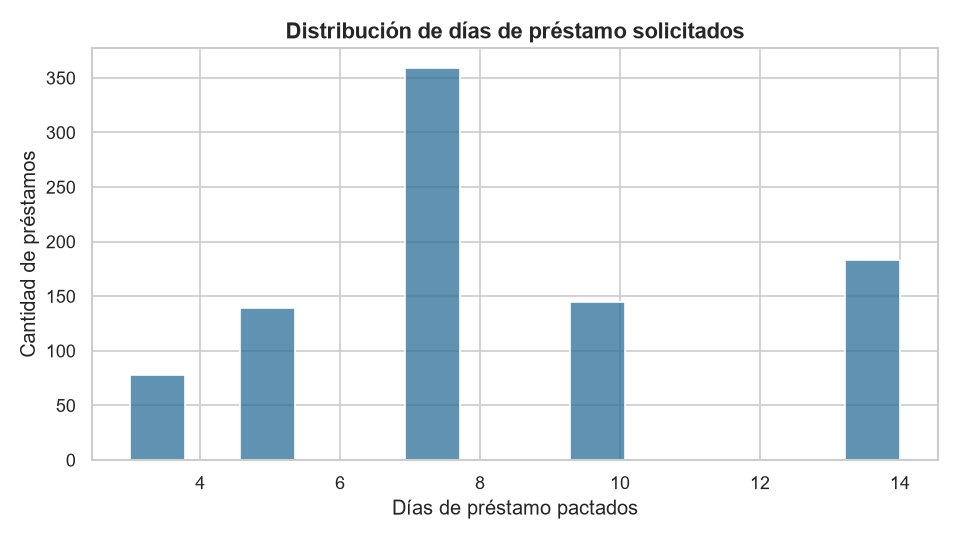
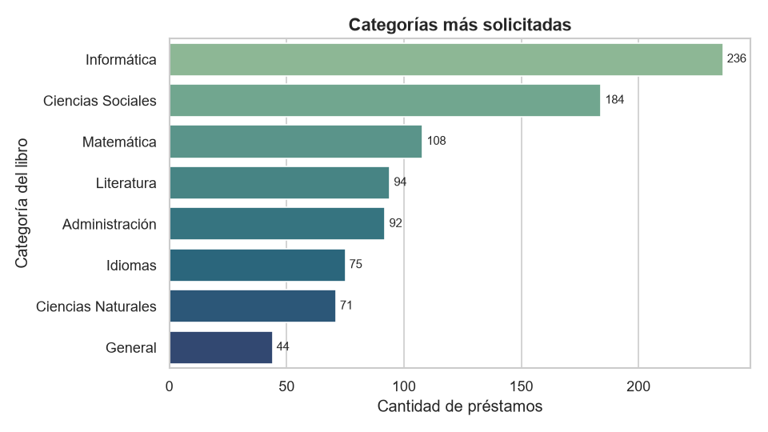
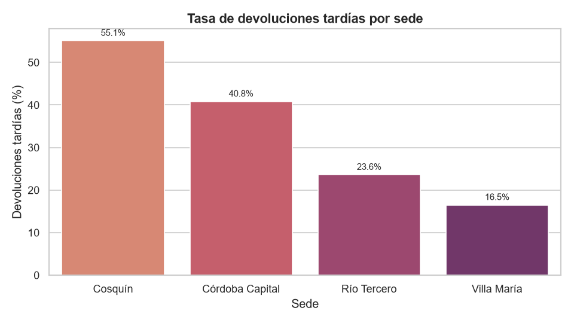
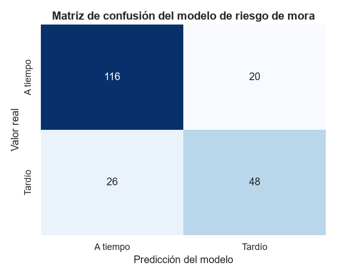

# Evidencias

## Gráficos del análisis exploratorio (RF4 y RF5)

| Archivo | Qué muestra |
|---|---|
| `eda_01_histograma_dias_prestamo.png` | Distribución de los días de préstamo solicitados. |
| `eda_02_categorias_mas_solicitadas.png` | Ranking de categorías: lideran Informática y Ciencias Sociales. |
| `eda_03_mora_por_sede.png` | Tasa de devoluciones tardías por sede, encabezada por Cosquín. |
| `modelo_01_matriz_de_confusion.png` | Matriz de confusión del modelo de riesgo de mora. |









## Salidas de ejecución

| Archivo | Qué contiene |
|---|---|
| `salida_demo_flujo.txt` | Recorrido completo del flujo con los mensajes reales del sistema: control de calidad, EDA, login, altas, validaciones (BT-01 a BT-08), reserva, predicción de riesgo, notificación y métricas. |

## Cómo regenerar todo

```bash
python scripts/generar_evidencias.py       # gráficos
python scripts/demo_flujo.py > docs/evidencias/salida_demo_flujo.txt   # salida de la demo
```

Las capturas de pantalla de la interfaz interactiva (pestañas de login, catálogo, reservas y dashboard) se toman desde el notebook en Google Colab durante la defensa; el notebook [`notebooks/BiblioTech_MVP.ipynb`](../../notebooks/BiblioTech_MVP.ipynb) ya está versionado **con las salidas de la última ejecución**, así que los gráficos y resultados se ven directamente en GitHub sin necesidad de ejecutarlo.
